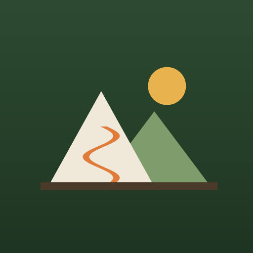
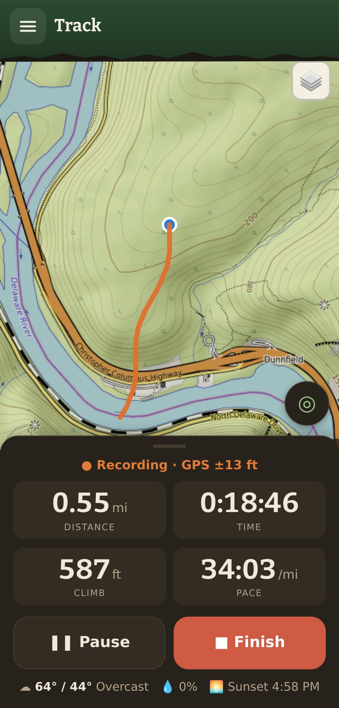
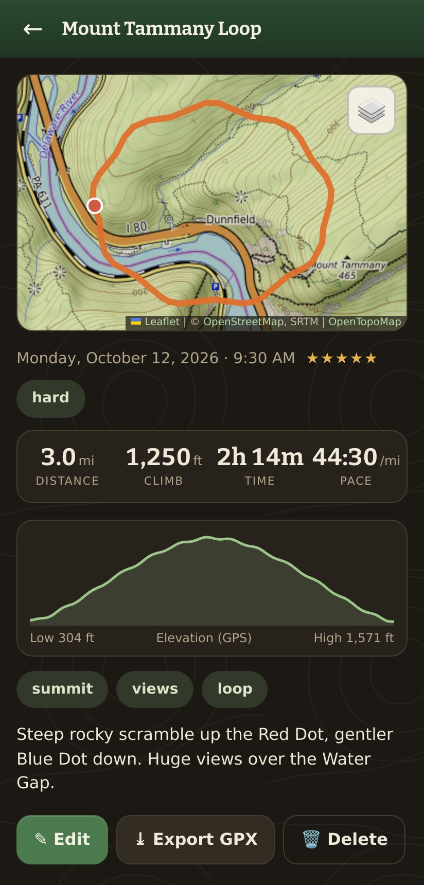
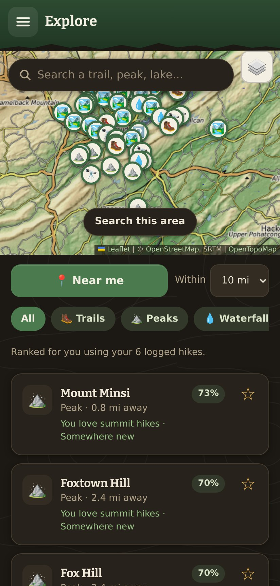
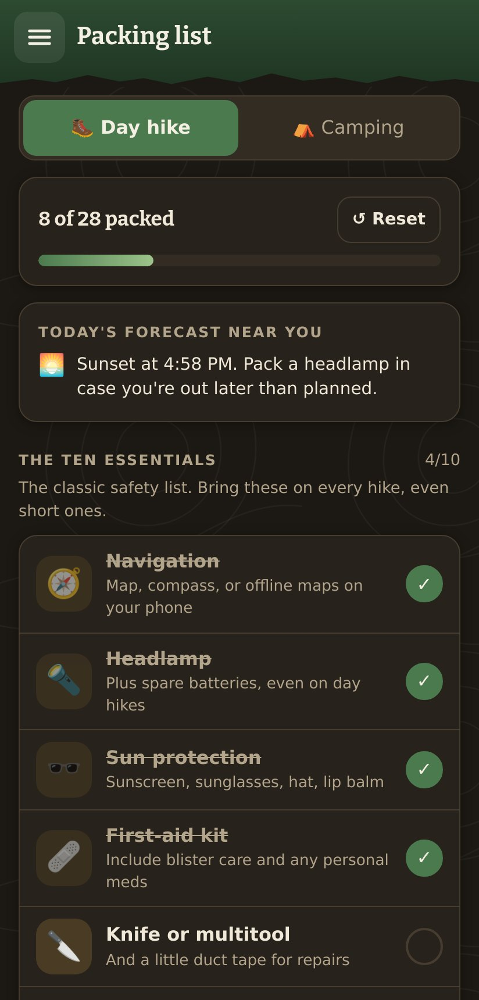
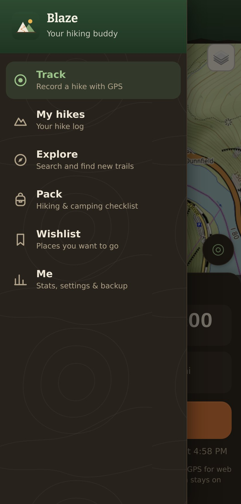
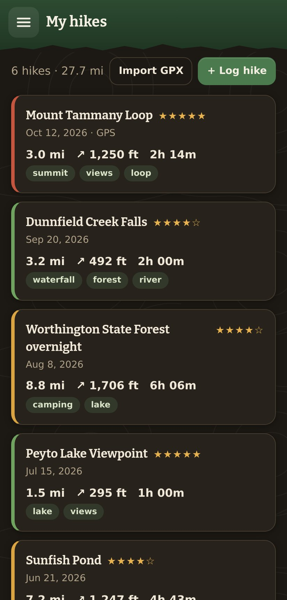
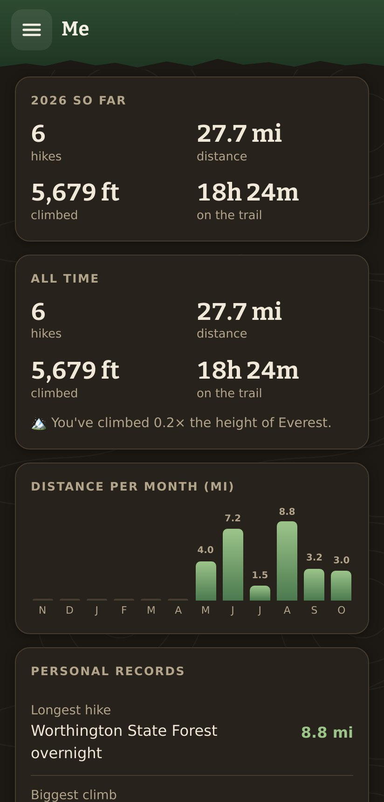

<div align="center">



# Blaze

**Your pocket hiking buddy.**
Track your hikes, keep a trail journal, discover new trails, and never forget your headlamp.


<br>

&nbsp;
&nbsp;
&nbsp;


</div>

---

> A **blaze** is the paint mark on a tree that tells you you're still on the trail.
> This app aims to do the same job, just in your pocket.

## ✨ What it does

### 🥾 Track
Hit **Start** and go. Blaze records your route with GPS and shows the essentials in big, glove-friendly numbers: **distance, time, climb, and pace**.
- Filters out GPS jitter and fuzzy fixes, so standing still doesn't add miles
- Keeps the screen awake while recording, and warns you as **sunset** approaches
- Pause/resume for lunch at the summit
- If your phone dies or the app closes, the hike is still there when you come back

### 📔 Your trail journal
Every hike gets its map, an **elevation profile**, stars, difficulty, tags, notes and photos.
- Log past hikes by hand: just tap where you went on the map
- **GPX import/export** to and from Strava, AllTrails, Gaia, Garmin and others
- Hike cards carry a colored "blaze" for difficulty: 🟢 easy, 🟡 moderate, 🔴 hard

### 🧭 Explore
- **Search any trail, peak, lake or park by name**, anywhere in the world
- **Near me** finds trails, peaks, waterfalls, viewpoints, lakes, campgrounds and trailheads around you
- Results are **ranked for you**, based on what you've logged and how you rated it:
  - *"You love waterfalls"*
  - *"About your usual distance"*
  - *"Somewhere new"*
- Each place shows a **3-day forecast**, the trail line, and one-tap **directions**
- Save places to your **wishlist**. When you finally go, tap *"I hiked it"* and it moves into your journal

### 🎒 Pack
A checklist for **day hikes** and **camping**, starting with the classic **Ten Essentials**.
- Every item has an icon and a short tip
- Add your own items
- The forecast adds reminders:
  - *🌧️ 60% chance of rain: pack your rain jacket*
  - *🥶 Low of 18°F: bring a warm hat and gloves*

### 📊 Me
Yearly and all-time totals, distance per month, and personal records. There's also a fun fact, like how many Everests you've climbed so far 🏔️

### 🌲 Built for the trail
- An earthy dark theme by default, plus a high-contrast **☀️ Sunlight mode** for bright days
- Big touch targets for gloved hands
- **Works offline**: the app opens without signal, and map tiles you've already viewed stay cached
- Android's back button closes menus and details, as you'd expect

<div align="center">
&nbsp;
&nbsp;

</div>

## 🚀 Get it on your phone

Blaze is a **Progressive Web App**. There's no app store and no build step: it's just static files. Android only allows GPS on secure (`https`) pages, so the files need a host.

**Easiest: GitHub Pages (free)**
1. In this repo, go to **Settings → Pages**. Under *Build and deployment*, pick **Deploy from a branch** → `main` / `/ (root)`.
2. After a minute your app is live at `https://<your-username>.github.io/blaze/`.
3. Open that link in **Chrome on Android**, tap **⋮ → Add to Home screen** (or **Install app**), and allow location.

That's it. Blaze now lives on your home screen like any other app.

> Any static host works too, e.g. drag the folder onto [Netlify Drop](https://app.netlify.com/drop).

## 💻 Run it locally

```bash
git clone https://github.com/mohannashahrad/blaze.git
cd blaze
python3 -m http.server 8000
```

Open <http://localhost:8000>. Browsers treat `localhost` as secure, so GPS and offline mode work. To try it as a phone, open DevTools → device toolbar. To fake a hike, use DevTools → *Sensors* → *Location*.

## 🧠 How the recommendations work

There's no AI service and no server, just a small scoring model that runs on your phone (`js/recommend.js`). It starts from your own journal:

| Signal | Comes from |
| --- | --- |
| **What you like** | Tags you use often and rate above your average (summits, lakes, waterfalls…) |
| **How far you hike** | The median distance of your logged hikes |
| **Where you've been** | Places within ~600 m of anywhere you've hiked get marked *"You've hiked here"* |
| **What's close** | Straight-line distance from where you searched |

Each suggestion explains itself, so you always know *why* it showed up.

## 🗺️ Where the data comes from

| | Service | Used for |
| --- | --- | --- |
| 🗺️ | [OpenStreetMap](https://www.openstreetmap.org) + [OpenTopoMap](https://opentopomap.org) | Topo and street maps |
| 🔎 | [Overpass API](https://overpass-api.de) | Trails, peaks and waterfalls near you |
| 📍 | [Nominatim](https://nominatim.org) | Search by name, and suggested hike names |
| ⛅ | [Open-Meteo](https://open-meteo.com) | Forecasts, sunset times and packing tips |

All of them are free, need no API keys, and get **no personal data**: just the map area or the coordinates being looked up.

> ⏳ Overpass is a free public service and is sometimes slow or busy, so a *Near me* search can take up to a minute. Blaze keeps your last results, so they show instantly (and offline) next time.

## 🔒 Privacy

- **No accounts, no tracking, no backend.** Your hikes, photos, wishlist and packing list live in your browser's storage on your phone.
- **Back up now and then** with *Me → Export backup*. That gives you one JSON file, photos included, that you can restore on any device.

## 🛠️ Under the hood

Plain HTML, CSS and JavaScript modules. No framework, no bundler, no `node_modules`.

```
index.html            app shell: header, menu, pages
css/styles.css        earthy trail theme + Sunlight mode
sw.js                 offline cache + map-tile cache
js/
├── app.js            menu, page switching, startup
├── track.js          live GPS recording
├── hikes.js          journal: list, detail, add/edit
├── explore.js        search + nearby discovery
├── place.js          place details: forecast, trail line, wishlist
├── pack.js           packing checklist  ·  pack-data.js  the items
├── saved.js          wishlist page      ·  wishlist.js   wishlist storage
├── me.js             stats, settings, backup
├── recommend.js      taste profile + scoring (pure functions)
├── geo.js            distance / climb / track math (pure functions)
├── osm.js            Overpass + Nominatim
├── weather.js        Open-Meteo
├── gpx.js            GPX import/export
├── map.js            Leaflet helpers
├── db.js             IndexedDB storage
└── util.js           DOM, formatting, units, sheets
```

**Tech:**
- [Leaflet](https://leafletjs.com) for maps
- IndexedDB for storage
- A service worker for offline use
- The Screen Wake Lock API to keep the screen on while tracking

> When you change app files, bump `VERSION` in `sw.js`. Installed copies then pick up the update on their own.

## ⚠️ Good to know

- **Keep Blaze open while recording.** Android pauses GPS for web apps when the screen locks, which is why Blaze keeps the screen on. If you switch away anyway, that stretch is drawn as a straight line.
- **GPS altitude is noisy.** Climb ignores wobbles under 6 m, so expect it to be close, not exact.
- **Search covers what OpenStreetMap has named.** A small local trail might only show up as its peak or lake.

## 🧗 Ideas for the trail ahead

- [ ] True background tracking (wrapping Blaze as a native app with Capacitor)
- [ ] Download a region's map tiles before a trip
- [ ] Share a hike as an image card
- [ ] Trip plans: pick a wishlist place, check the forecast, and pack for it in one flow
- [ ] Gear tracker (miles on your boots)

## 🙏 Credits

Map data © [OpenStreetMap contributors](https://www.openstreetmap.org/copyright), available under the ODbL. Map style © OpenTopoMap (CC-BY-SA). Weather data by Open-Meteo.

<div align="center">
<br>
<b>Happy trails!</b> 🥾🌲⛰️
</div>
